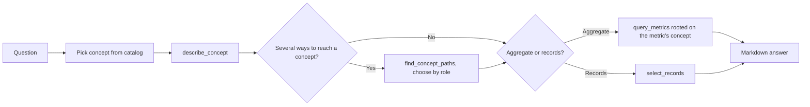

# OntologyAnalyst Guide

## Overview

`ontology_analyst` is a built-in subagent for data questions over a datasource that has an [Apache Ossie](https://github.com/apache/ossie) ontology. It works like [AskMetrics](ask_metrics.md): it answers from the semantic layer and never writes raw SQL. It also reads the ontology, which gives it four kinds of information that the semantic model alone does not have:

- **The subject concept.** A concept catalog (Flight, Airport, FlightAlert, ...) is in the agent's context from the first turn, so it does not have to guess which table a question is about.
- **Allowed filter values.** Properties such as `FlightAlert.status` carry a closed value set (`OPEN`, `RESOLVED`). Dosi refuses a guessed literal such as `'unresolved'` before compiling and returns the allowed values.
- **Relationship roles.** A flight reaches an airport as `arrives_at` (destination) and as `departs_from` (origin). The agent lists the paths, sees which ones the ontology declares equivalent, and picks the role that matches the question.
- **Where to group a metric.** When a metric is grouped from the wrong concept, Dosi returns the correctly rooted path, for example `Delay.flight.arrives_at.code` instead of `Flight.arrives_at.code`.

OntologyAnalyst can also return **individual records**, such as "list the open P1 alerts on flights into JFK", which AskMetrics cannot.

## Prerequisites

1. The datasource has executable semantic models under `subject/semantic_models/<datasource>/`, the same as for AskMetrics. The one exception is a mapping that carries its model inline (see below), which needs no model file.
2. Ontologies go in the project-wide `subject/ontology/` directory, next to `semantic_models/`, together with Apache Ossie **mapping documents** that bind each ontology to semantic models:

    ```text
    subject/
    ├── semantic_models/
    │   ├── aviation/
    │   │   └── aviation.yaml                  # OSI semantic model
    │   └── airline_ops/
    │       └── crews.yaml
    └── ontology/
        ├── aviation.ontology.yaml             # Ossie ontology
        ├── aviation-aviation.mapping.yaml     # → ../semantic_models/aviation/aviation.yaml
        └── aviation-crews.mapping.yaml        # → ../semantic_models/airline_ops/crews.yaml
    ```

    An ontology is not tied to one datasource: it may have several mapping documents, each mapping it onto one semantic model file, and those models may belong to different datasources. `subject/ontology/` is therefore flat; subdirectories are not read.

    Each mapping names its model by `semantic_model_ref.iri`, a path relative to the mapping file. The datasource whose model directory that path lands in loads the mapping; other datasources ignore it. Its `ontology_ref` finds the ontology by `iri` (relative to the mapping) or, without one, by name among the ontology documents in the directory.

    The `<ontology>.ontology.yaml` / `<ontology>-<model>.mapping.yaml` names are only a convention for readers. Datus tells files apart by their contents and follows the references, never the file names.

    A mapping can also carry its model inline under `semantic_model_ref.document`. Such a mapping is a self-contained document that belongs to no datasource in particular: every datasource loads it, executed on that datasource's connection.

    A mapping without a local model `iri`, one whose `iri` names a model file missing from the datasource's directory, two mappings onto one model, an ontology no mapping uses, and any other file in the directory are reported, not guessed.

3. The installed `dosi-engine` must expose the ontology API (`Engine.describe` / `Engine.paths`) and load mapping documents (`Engine` accepts `mapping_path`, Datus-ai/osi-engine#303 or later).

Only OntologyAnalyst loads the ontology. AskMetrics and every other agent keep working on the plain model.

If any prerequisite is missing, OntologyAnalyst refuses on its first turn, says what is missing, and points to `ask_metrics`. It never falls back to a plain-metric answer without saying so. The main agent offers `ontology_analyst` for delegation only when a mapping document in `subject/ontology/` binds a model of the current datasource (or carries its model inline).

## Quick Start: the Aviation Example

This walkthrough uses the aviation example shipped in the Datus-agent repository (the Dosi aviation scenario). The data is small, so you can check every answer by hand:

| File | Contents |
|------|----------|
| `tests/data/semantic_models/aviation/aviation.yaml` | OSI semantic model `aviation`: 9 tables, with delay, alert and passenger metrics |
| `tests/data/ontology/aviation.ontology.yaml` | Ossie ontology: Flight, Airport, FlightAlert, Delay and other concepts, with their roles and value domains |
| `tests/data/ontology/aviation-aviation.mapping.yaml` | Mapping document binding that ontology to `semantic_models/aviation/aviation.yaml` |
| `tests/data/semantic_models/aviation/seed.sql` | Seed data: 13 flights with their delays and alerts |

### 1. Prepare the project and the database

Datus treats the directory you start it in as the project root, and `subject/` lives there. Set `DATUS_REPO` to your local Datus-agent checkout:

```bash
export DATUS_REPO=~/src/Datus-agent
mkdir -p ~/ontology-demo && cd ~/ontology-demo

# Model, ontology and mapping document, in the conventional layout
mkdir -p subject/semantic_models/aviation subject/ontology
cp $DATUS_REPO/tests/data/semantic_models/aviation/aviation.yaml subject/semantic_models/aviation/
cp $DATUS_REPO/tests/data/ontology/aviation{.ontology,-aviation.mapping}.yaml subject/ontology/

# Build a DuckDB database from the seed (duckdb is installed with Datus)
python -c "import duckdb, pathlib; duckdb.connect('aviation.duckdb').execute(pathlib.Path('$DATUS_REPO/tests/data/semantic_models/aviation/seed.sql').read_text())"
```

The result:

```text
~/ontology-demo/
├── aviation.duckdb
└── subject/
    ├── semantic_models/aviation/aviation.yaml
    └── ontology/
        ├── aviation.ontology.yaml
        └── aviation-aviation.mapping.yaml
```

`aviation-aviation.mapping.yaml` reaches its model by `semantic_model_ref.iri: ../semantic_models/aviation/aviation.yaml`, so it belongs to the `aviation` datasource, and its ontology by `ontology_ref.iri: ./aviation.ontology.yaml`.

!!! tip "One-file layout"
    A mapping document can also carry the ontology and the model inline under `document:`. It then needs no model directory, and every datasource loads it. `tests/data/ontology_inline/` is a small example, with its own `seed.sql`.

### 2. Register the datasource

Add the datasource to `agent.yml` (by default `~/.datus/conf/agent.yml`). **The datasource name must match the directory name `aviation`:**

```yaml
agent:
  services:
    datasources:
      aviation:
        type: duckdb
        uri: ~/ontology-demo/aviation.duckdb
```

### 3. Start Datus and select OntologyAnalyst

```bash
cd ~/ontology-demo
datus --datasource aviation
```

```text
/agent ontology_analyst
```

You can also stay in the main chat. The main agent delegates to `ontology_analyst` once it sees that the datasource has an ontology. To route a single question, append `@Agent ontology_analyst` to it.

### 4. Ask, and check the answers

Each question is phrased the way a business user would ask it, without metric or field names. The last column says what the ontology contributes.

| Question | Expected answer | What it tests |
|----------|-----------------|---------------|
| Among flights to JFK, which P1 alerts are still open? Give the alert id, type, flight number and airport name. | A007 (WEATHER, SK202) and A011 (AIR_TRAFFIC, UA402), airport John F. Kennedy International Airport | Record query; two hops plus the arrival role; "still open" must map to the domain value `OPEN` |
| How many alerts are still unresolved? Break it down by priority. | P0 1, P1 3, P2 4 (8 in total) | "Unresolved" is not a valid value and must map to `OPEN` |
| Which destination airport has the most delayed flights? List the delayed flight count per destination airport. | LAX 3, JFK 2, SFO 2, SEA 1 | The metric is grouped from `Delay` through the `arrives_at` role |
| By origin airport, which airport has the most delayed flights? List the delayed flight count per origin airport. | SFO 6, JFK 1, LAS 1 | The same metric through `departs_from`. Numbers equal to the previous answer mean the roles were confused |
| Looking only at flights scheduled to depart on 2026-08-14 and 2026-08-15, how many delayed flights does each destination airport have? | JFK 1, LAX 1, SFO 1, and no SEA | The time axis comes from `Delay.flight.scheduled_departure` |
| Which delayed flights also have alerts? List the flight number, delay minutes and alert count. | SK202 95/2, SK103 60/2, SK201 55/1, SK102 42/2, UA303 30/1, UA401 29/1, UA302 25/1 | Delays and alerts are two collections under one flight. Group by flight; a record join of both would inflate the minutes |

Start a new session (`/clear`) for each question so that one answer does not inform the next.

### 5. Watch what the agent does

Tool calls appear in the conversation. Things to look for:

- `describe_concept("FlightAlert")` shows `FlightAlert.status` with `domain: [OPEN, RESOLVED]`.
- `find_concept_paths("Flight", "Airport")` returns four paths and two equivalences: "the airport" has only two meanings.
- If the agent first tries a literal such as `'unresolved'`, it gets `value_not_in_domain` with the allowed values and retries with `OPEN`.
- If it groups `delayed_flights` by `Flight.arrives_at.code`, it gets `invalid_relationship_path` with `Delay.flight.arrives_at.code` in `candidates`, and retries with that path.

### 6. Troubleshooting

| Message | Cause and fix |
|---------|---------------|
| `ontology_analyst is unavailable: no ontology for datasource 'aviation'` | No mapping in `subject/ontology/` names a model under `subject/semantic_models/aviation/`. Check each mapping's `semantic_model_ref.iri`, that the model directory name matches the datasource name, and that Datus was started in the project root |
| `... could not be bound to a semantic model` | Listed after `no ontology for datasource`. `subject/ontology/` is project-wide, so a listed file may belong to any datasource. A mapping has no local `semantic_model_ref.iri`, its `iri` names a model file missing from this datasource's directory or a path outside every `subject/semantic_models/<datasource>/`, two mappings name the same model, an ontology is used by no mapping, or the file is neither an ontology nor a mapping document (a semantic model belongs under `subject/semantic_models/<datasource>/`). Fix the mapping, add one for the ontology, or move the file out |
| `the installed dosi-engine binding cannot describe ontologies` | `dosi-engine` is too old. Upgrade to a build whose `Engine` has `describe` and `paths` |
| `... is an Ossie mapping document, and the installed dosi-engine cannot load one` | `dosi-engine` predates mapping documents. Upgrade it |
| The main agent does not delegate to `ontology_analyst` | It is offered only when a mapping binds a model of the current datasource. Use `/agent ontology_analyst` or `@Agent ontology_analyst` |

## Usage

Ask in the main chat. When the datasource has an ontology, the main agent delegates suitable questions automatically:

```text
Which P1 alerts are still open on flights into JFK? Give alert id, flight number and airport name.
```

To route one question explicitly:

```text
Which destination airport has the most delayed flights? @Agent ontology_analyst
```

For several questions in a row:

```text
/agent ontology_analyst
```

Web/API callers route with `subagent_id: "ontology_analyst"`.

## How It Works



Concept paths such as `FlightAlert.flight.arrives_at.name` work anywhere a field is accepted: in `query_metrics` dimensions and filters, and in `select_records` fields and filters. Dosi compiles them to the same SQL as the dataset spelling. Rejections such as `value_not_in_domain`, `invalid_relationship_path` and `unknown_concept` come back as structured tool results with `candidates`, `hint` and `detail`, and the agent retries from those.

## Default Tools

| Tool | Purpose |
|------|---------|
| `semantic_tools.describe_concept` | Concept catalog, or one concept's properties, value domains, links, groupable metrics and time axes |
| `semantic_tools.find_concept_paths` | Every named path between two concepts (up to 3 hops), with roles and equivalences |
| `semantic_tools.select_records` | Record-level query rooted on one concept (default 200 rows; the full result is cached) |
| `semantic_tools.list_metrics` | Enumerate executable metrics |
| `semantic_tools.get_metric` | Describe one metric |
| `semantic_tools.query_metrics` | Query metric values |
| `semantic_tools.attribution_analyze` | Explain metric movement across dimensions |
| `context_search_tools.search_metrics` | Find candidate metrics by wording |

## Configuration

```yaml
agent:
  agentic_nodes:
    ontology_analyst:
      model: claude
      max_turns: 30
      # Concepts inlined into the prompt at startup; above this only names are listed.
      concept_catalog_prompt_limit: 60
```

### Custom OntologyAnalyst Agents

```yaml
agent:
  agentic_nodes:
    flight_ops:
      type: ontology_analyst
      agent_description: "Answer flight operations questions."
      tools: "semantic_tools.describe_concept,semantic_tools.find_concept_paths,semantic_tools.select_records,semantic_tools.query_metrics"
```

A custom agent first looks for its own prompt template (`flight_ops_system_1.0.j2`), then falls back to the built-in `ontology_analyst_system` template.

## Limitations

These follow from the Dosi ontology support:

- Paths are searched up to three hops.
- A concept stored on another concept's table (for example a state stored on the airport table) cannot be the root of a query.
- Value domains are checked only for `=` and `IN` against literals. Ranges are not checked.
- An n-ary relationship and a row-level `derived_by` are not lowered into the model.
- A model field that the ontology does not map, such as a distance band, cannot be reached through a concept path. Its `dataset.field` name still works.

## AskMetrics or OntologyAnalyst

| Situation | Use |
|-----------|-----|
| The datasource has no ontology | [ask_metrics](ask_metrics.md) |
| KPI values and trends on a datasource with an ontology | `ontology_analyst` |
| The answer depends on a relationship role (origin or destination) | `ontology_analyst` |
| Listing individual records | `ontology_analyst` |
| Generating or fixing SQL over raw tables | [gen_sql](builtin_subagents.md#gen_sql) |
