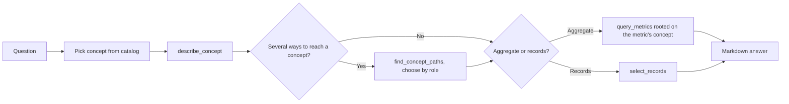

# OntologyAnalyst Guide

## Overview

`ontology_analyst` is a built-in subagent for data questions over a datasource that has an [Apache Ossie](https://github.com/apache/ossie) ontology. It works like [AskMetrics](ask_metrics.md): it answers from the semantic layer and never writes raw SQL. It also reads the ontology, which gives it four kinds of information that the semantic model alone does not have:

- **The subject concept.** A concept catalog (Flight, Airport, FlightAlert, ...) is in the agent's context from the first turn, so it does not have to guess which table a question is about.
- **Allowed filter values.** Properties such as `FlightAlert.status` carry a closed value set (`OPEN`, `RESOLVED`). Dosi refuses a guessed literal such as `'unresolved'` before compiling and returns the allowed values.
- **Relationship roles.** A flight reaches an airport as `arrives_at` (destination) and as `departs_from` (origin). The agent lists the paths, sees which ones the ontology declares equivalent, and picks the role that matches the question.
- **Where to group a metric.** When a metric is grouped from the wrong concept, Dosi returns the correctly rooted path, for example `Delay.flight.arrives_at.code` instead of `Flight.arrives_at.code`.

OntologyAnalyst can also return **individual records**, such as "list the open P1 alerts on flights into JFK", which AskMetrics cannot.

## Prerequisites

1. The datasource has executable semantic models under `subject/semantic_models/<datasource>/`, the same as for AskMetrics.
2. Each ontology file is placed under `subject/semantic_models/ontology/<datasource>/` and named after the model file it describes:

    ```text
    subject/semantic_models/
    ├── aviation/
    │   └── aviation.yaml            # OSI semantic model
    └── ontology/
        └── aviation/
            └── aviation.yaml        # Ossie ontology for aviation.yaml
    ```

    When a datasource has exactly one model file and one ontology file, the names do not have to match. An ontology file that matches no model file is reported, not guessed. No datasource can be named `ontology`.

3. The installed `dosi-engine` must expose the ontology API (`Engine.describe` / `Engine.paths`).

Only OntologyAnalyst loads the ontology. AskMetrics and every other agent keep working on the plain model.

If any prerequisite is missing, OntologyAnalyst refuses on its first turn, says what is missing, and points to `ask_metrics`. It never falls back to a plain-metric answer without saying so. The main agent offers `ontology_analyst` for delegation only when the current datasource has an ontology directory with at least one file in it.

## Usage

Ask in the main chat. When the datasource has an ontology, the main agent delegates suitable questions automatically:

```text
Which P1 alerts are still open on flights into JFK? Give alert id, flight number and airport name.
```

To route one question explicitly:

```text
Which destination airport has the most delayed flights? @Agent ontology_analyst
```

For several questions in a row:

```text
/agent ontology_analyst
```

Web/API callers route with `subagent_id: "ontology_analyst"`.

## How It Works



Concept paths such as `FlightAlert.flight.arrives_at.name` work anywhere a field is accepted: in `query_metrics` dimensions and filters, and in `select_records` fields and filters. Dosi compiles them to the same SQL as the dataset spelling. Rejections such as `value_not_in_domain`, `invalid_relationship_path` and `unknown_concept` come back as structured tool results with `candidates`, `hint` and `detail`, and the agent retries from those.

## Default Tools

| Tool | Purpose |
|------|---------|
| `semantic_tools.describe_concept` | Concept catalog, or one concept's properties, value domains, links, groupable metrics and time axes |
| `semantic_tools.find_concept_paths` | Every named path between two concepts (up to 3 hops), with roles and equivalences |
| `semantic_tools.select_records` | Record-level query rooted on one concept (default 200 rows; the full result is cached) |
| `semantic_tools.list_metrics` | Enumerate executable metrics |
| `semantic_tools.get_metric` | Describe one metric |
| `semantic_tools.query_metrics` | Query metric values |
| `semantic_tools.attribution_analyze` | Explain metric movement across dimensions |
| `context_search_tools.search_metrics` | Find candidate metrics by wording |

## Configuration

```yaml
agent:
  agentic_nodes:
    ontology_analyst:
      model: claude
      max_turns: 30
      # Required when an ontology file declares several ontology_mappings.
      ontology_mapping: departures
      # Concepts inlined into the prompt at startup; above this only names are listed.
      concept_catalog_prompt_limit: 60
```

### Custom OntologyAnalyst Agents

```yaml
agent:
  agentic_nodes:
    flight_ops:
      type: ontology_analyst
      agent_description: "Answer flight operations questions."
      tools: "semantic_tools.describe_concept,semantic_tools.find_concept_paths,semantic_tools.select_records,semantic_tools.query_metrics"
```

A custom agent first looks for its own prompt template (`flight_ops_system_1.0.j2`), then falls back to the built-in `ontology_analyst_system` template.

## Limitations

These follow from the Dosi ontology support:

- Paths are searched up to three hops.
- A concept stored on another concept's table (for example a state stored on the airport table) cannot be the root of a query.
- Value domains are checked only for `=` and `IN` against literals. Ranges are not checked.
- An n-ary relationship and a row-level `derived_by` are not lowered into the model.
- A model field that the ontology does not map, such as a distance band, cannot be reached through a concept path. Its `dataset.field` name still works.

## AskMetrics or OntologyAnalyst

| Situation | Use |
|-----------|-----|
| The datasource has no ontology | [ask_metrics](ask_metrics.md) |
| KPI values and trends on a datasource with an ontology | `ontology_analyst` |
| The answer depends on a relationship role (origin or destination) | `ontology_analyst` |
| Listing individual records | `ontology_analyst` |
| Generating or fixing SQL over raw tables | [gen_sql](builtin_subagents.md#gen_sql) |
