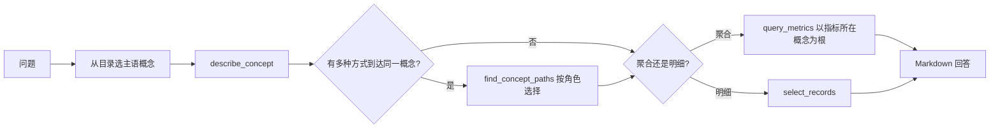

# OntologyAnalyst 指南

## 概述

`ontology_analyst` 是内置子代理，用于回答带有 [Apache Ossie](https://github.com/apache/ossie) ontology 的数据源上的数据问题。它和 [AskMetrics](ask_metrics.zh.md) 一样只走语义层、不写裸 SQL，但还会读取 ontology，从中获得语义模型本身没有的四类信息：

- **主语概念**：概念目录（Flight、Airport、FlightAlert……）从第一轮起就在上下文里，不用猜问题落在哪张表。
- **允许的过滤值**：`FlightAlert.status` 这类属性带有封闭值域（`OPEN`、`RESOLVED`）。猜错的字面量（如 `'unresolved'`）会在编译前被 Dosi 拒绝，并返回允许值。
- **关系角色**：航班通过 `arrives_at`（目的地）和 `departs_from`（出发地）两种方式到达机场。代理会列出所有路径、查看 ontology 声明哪些等价，再按问题选择对应角色。
- **指标从哪里分组**：指标从错误的概念分组时，Dosi 会给出正确的根路径，例如用 `Delay.flight.arrives_at.code` 代替 `Flight.arrives_at.code`。

OntologyAnalyst 还能返回**明细记录**，例如“列出飞往 JFK 的航班上未关闭的 P1 告警”，这是 AskMetrics 做不到的。

## 前置条件

1. 数据源在 `subject/semantic_models/<datasource>/` 下有可执行的语义模型（与 AskMetrics 相同）。
2. ontology 文件放在 `subject/semantic_models/ontology/<datasource>/` 下，文件名与它描述的模型文件相同：

    ```text
    subject/semantic_models/
    ├── aviation/
    │   └── aviation.yaml            # OSI 语义模型
    └── ontology/
        └── aviation/
            └── aviation.yaml        # aviation.yaml 对应的 Ossie ontology
    ```

    数据源只有一个模型文件和一个 ontology 文件时，文件名可以不同。配不上任何模型文件的 ontology 会被报告出来，不会自动猜测。数据源不能命名为 `ontology`。

3. 安装的 `dosi-engine` 需要提供 ontology API（`Engine.describe` / `Engine.paths`）。

只有 OntologyAnalyst 会加载 ontology，AskMetrics 和其他代理继续使用原模型。

缺少任何前置条件时，OntologyAnalyst 会在第一轮拒绝执行，说明缺了什么，并引导使用 `ask_metrics`；它不会在没有提示的情况下退化成普通指标问答。只有当前数据源的 ontology 目录里至少有一个文件时，主代理才会提供 `ontology_analyst` 作为可委派的子代理。

## 快速上手：航空示例

本节用 Datus-agent 仓库自带的航空示例（Dosi aviation 场景）完整体验一遍。数据很小，每个答案都可以手工核对：

| 文件 | 内容 |
|------|------|
| `tests/data/semantic_models/aviation/aviation.yaml` | OSI 语义模型：9 张表，以及延误、告警、载客等指标 |
| `tests/data/semantic_models/ontology/aviation/aviation.yaml` | Ossie ontology：Flight、Airport、FlightAlert、Delay 等概念，以及它们之间的角色和值域 |
| `tests/data/semantic_models/aviation/seed.sql` | 种子数据：13 个航班、延误和告警记录 |

### 1. 准备项目目录和数据库

Datus 以启动时的当前目录作为项目根目录，`subject/` 也放在这个目录下。把下面的 `DATUS_REPO` 换成你本地 Datus-agent 仓库的路径：

```bash
export DATUS_REPO=~/src/Datus-agent
mkdir -p ~/ontology-demo && cd ~/ontology-demo

# 语义模型和 ontology，按约定的目录放置
mkdir -p subject/semantic_models/aviation subject/semantic_models/ontology/aviation
cp $DATUS_REPO/tests/data/semantic_models/aviation/aviation.yaml subject/semantic_models/aviation/
cp $DATUS_REPO/tests/data/semantic_models/ontology/aviation/aviation.yaml subject/semantic_models/ontology/aviation/

# 用种子数据生成 DuckDB 数据库（duckdb 随 Datus 一起安装）
python -c "import duckdb, pathlib; duckdb.connect('aviation.duckdb').execute(pathlib.Path('$DATUS_REPO/tests/data/semantic_models/aviation/seed.sql').read_text())"
```

完成后的目录结构：

```text
~/ontology-demo/
├── aviation.duckdb
└── subject/semantic_models/
    ├── aviation/aviation.yaml
    └── ontology/aviation/aviation.yaml
```

### 2. 注册数据源

在 `agent.yml`（默认位于 `~/.datus/conf/agent.yml`）中添加数据源。**数据源名必须与目录名 `aviation` 一致**：

```yaml
agent:
  services:
    datasources:
      aviation:
        type: duckdb
        uri: ~/ontology-demo/aviation.duckdb
```

### 3. 启动并切换到 OntologyAnalyst

```bash
cd ~/ontology-demo
datus --datasource aviation
```

```text
/agent ontology_analyst
```

也可以留在主对话中，主代理检测到该数据源有 ontology 后会自动委派；或者在单个问题末尾加 `@Agent ontology_analyst`。

### 4. 提问并核对答案

以下问题都按业务人员的口吻提出，不包含指标名或字段名。“考察点”一列说明 ontology 在其中起什么作用。

| 问题 | 预期答案 | 考察点 |
|------|---------|--------|
| 飞往 JFK 的航班里，有哪些未关闭的 P1 告警？给出告警号、类型、航班号和机场名。 | A007（WEATHER，SK202）和 A011（AIR_TRAFFIC，UA402），机场为 John F. Kennedy International Airport | 明细查询；两跳 + 到达角色；“未关闭”需要映射到值域里的 `OPEN` |
| 现在还有多少未解决的告警？按优先级分。 | P0 1 条、P1 3 条、P2 4 条，共 8 条 | “未解决”不是合法值，需要映射到 `OPEN` |
| 哪个目的地机场的延误航班最多？列出各目的地机场的延误航班数。 | LAX 3、JFK 2、SFO 2、SEA 1 | 指标要以 `Delay` 为根分组，经由 `arrives_at` 角色 |
| 按出发机场统计，哪个机场的延误航班最多？列出各出发机场的延误航班数。 | SFO 6、JFK 1、LAS 1 | 同一个指标换成 `departs_from` 角色。如果答案和上一题相同，说明角色混淆了 |
| 只看计划在 2026-08-14 和 2026-08-15 这两天起飞的航班，各目的地机场分别有多少延误航班？ | JFK 1、LAX 1、SFO 1，不应出现 SEA | 时间轴来自 `Delay.flight.scheduled_departure` |
| 哪些延误的航班同时有告警？列出航班号、延误分钟数和告警数。 | SK202 95/2、SK103 60/2、SK201 55/1、SK102 42/2、UA303 30/1、UA401 29/1、UA302 25/1 | 两个子集合（延误、告警）挂在同一航班下，必须按航班分组，不能做明细 join（否则分钟数会被放大） |

每个问题建议开一个新会话（`/clear`），避免上一题的发现影响下一题。

### 5. 观察代理的过程

工具调用会显示在对话中，重点看下面几项：

- `describe_concept("FlightAlert")` 返回的 `FlightAlert.status` 带有 `domain: [OPEN, RESOLVED]`；
- `find_concept_paths("Flight", "Airport")` 返回 4 条路径和 2 组等价关系，说明“机场”实际只有两种含义；
- 如果代理先用了 `'unresolved'` 这样的字面量，会收到 `value_not_in_domain` 和允许值列表，随后改用 `OPEN` 重试；
- 如果代理用 `Flight.arrives_at.code` 对 `delayed_flights` 分组，会收到 `invalid_relationship_path`，`candidates` 中给出 `Delay.flight.arrives_at.code`，代理随后按它重试。

### 6. 常见问题

| 提示信息 | 原因和处理 |
|---------|-----------|
| `ontology_analyst is unavailable: no ontology for datasource 'aviation'` | `subject/semantic_models/ontology/aviation/` 不存在或为空；检查目录名与数据源名一致，以及是否在项目根目录启动 |
| `... pair with no semantic model file` | 数据源有多个模型文件，而 ontology 文件名与任何模型文件都不同；把 ontology 改成与对应模型同名 |
| `the installed dosi-engine binding cannot describe ontologies` | 安装的 `dosi-engine` 版本过旧，升级到提供 `Engine.describe` / `Engine.paths` 的版本 |
| `... ontology_mapping_unresolved` | ontology 声明了多个 `ontology_mappings`；在 `agentic_nodes.ontology_analyst.ontology_mapping` 中指定一个 |
| 主代理不委派给 `ontology_analyst` | 只有当前数据源有 ontology 文件时才会提供；可以用 `/agent ontology_analyst` 或 `@Agent ontology_analyst` 显式指定 |

## 使用方式

直接在主对话中提问。数据源有 ontology 时，主代理会自动委派合适的问题：

```text
飞往 JFK 的航班里，有哪些未关闭的 P1 告警？给出告警号、航班号和机场名。
```

显式路由单个问题：

```text
哪个目的地机场的延误航班最多？ @Agent ontology_analyst
```

连续提问：

```text
/agent ontology_analyst
```

Web/API 调用方使用 `subagent_id: "ontology_analyst"`。

## 工作方式



`FlightAlert.flight.arrives_at.name` 这样的概念路径可以用在任何接受字段的地方：`query_metrics` 的维度和过滤条件，以及 `select_records` 的字段和过滤条件。Dosi 编译出的 SQL 与 dataset 写法相同。`value_not_in_domain`、`invalid_relationship_path`、`unknown_concept` 等拒绝会作为结构化工具结果返回，附带 `candidates`、`hint`、`detail`，代理据此重试。

## 默认工具

| 工具 | 用途 |
|------|------|
| `semantic_tools.describe_concept` | 概念目录，或单个概念的属性、值域、链接、可分组指标和时间轴 |
| `semantic_tools.find_concept_paths` | 两个概念之间的所有命名路径（最多 3 跳），附角色和等价关系 |
| `semantic_tools.select_records` | 以某个概念为根的明细查询（默认 200 行，完整结果会缓存） |
| `semantic_tools.list_metrics` | 列出可执行指标 |
| `semantic_tools.get_metric` | 描述单个指标 |
| `semantic_tools.query_metrics` | 查询指标值 |
| `semantic_tools.attribution_analyze` | 跨维度解释指标变化 |
| `context_search_tools.search_metrics` | 按措辞查找候选指标 |

## 配置

```yaml
agent:
  agentic_nodes:
    ontology_analyst:
      model: claude
      max_turns: 30
      # ontology 文件声明了多个 ontology_mappings 时必须指定
      ontology_mapping: departures
      # 启动时内联到提示词的概念数上限，超过后只列概念名
      concept_catalog_prompt_limit: 60
```

### 自定义 OntologyAnalyst 代理

```yaml
agent:
  agentic_nodes:
    flight_ops:
      type: ontology_analyst
      agent_description: "回答航班运营问题。"
      tools: "semantic_tools.describe_concept,semantic_tools.find_concept_paths,semantic_tools.select_records,semantic_tools.query_metrics"
```

自定义代理会先查找自己的提示词模板（`flight_ops_system_1.0.j2`），找不到时回退到内置的 `ontology_analyst_system` 模板。

## 限制

以下限制来自 Dosi 的 ontology 支持：

- 路径搜索最多 3 跳。
- 存放在其他概念表上的概念（例如存放在机场表上的州）不能作为查询根。
- 值域只对 `=` 和 `IN` 字面量做检查，不检查范围。
- n 元关系和行级 `derived_by` 不会下沉到模型中。
- ontology 没有映射的模型字段（例如距离分段）无法通过概念路径访问，但仍可以使用 `dataset.field` 写法。

## AskMetrics 还是 OntologyAnalyst

| 场景 | 使用 |
|------|------|
| 数据源没有 ontology | [ask_metrics](ask_metrics.zh.md) |
| 有 ontology 的数据源上的 KPI 和趋势 | `ontology_analyst` |
| 答案取决于关系角色（出发地还是目的地） | `ontology_analyst` |
| 列出明细记录 | `ontology_analyst` |
| 在原始表上生成或修复 SQL | [gen_sql](builtin_subagents.zh.md#gen_sql) |
