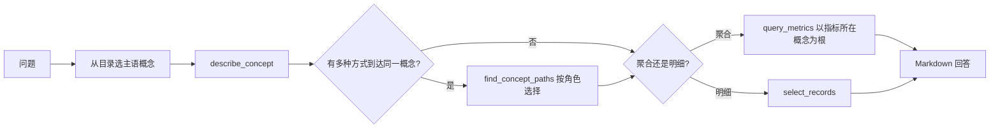

# OntologyAnalyst 指南

## 概述

`ontology_analyst` 是内置子代理，用于回答带有 [Apache Ossie](https://github.com/apache/ossie) ontology 的数据源上的数据问题。它和 [AskMetrics](ask_metrics.zh.md) 一样只走语义层、不写裸 SQL，但还会读取 ontology，从中获得语义模型本身没有的四类信息：

- **主语概念**：概念目录（Flight、Airport、FlightAlert……）从第一轮起就在上下文里，不用猜问题落在哪张表。
- **允许的过滤值**：`FlightAlert.status` 这类属性带有封闭值域（`OPEN`、`RESOLVED`）。猜错的字面量（如 `'unresolved'`）会在编译前被 Dosi 拒绝，并返回允许值。
- **关系角色**：航班通过 `arrives_at`（目的地）和 `departs_from`（出发地）两种方式到达机场。代理会列出所有路径、查看 ontology 声明哪些等价，再按问题选择对应角色。
- **指标从哪里分组**：指标从错误的概念分组时，Dosi 会给出正确的根路径，例如用 `Delay.flight.arrives_at.code` 代替 `Flight.arrives_at.code`。

OntologyAnalyst 还能返回**明细记录**，例如“列出飞往 JFK 的航班上未关闭的 P1 告警”，这是 AskMetrics 做不到的。

## 前置条件

1. 数据源在 `subject/semantic_models/<datasource>/` 下有可执行的语义模型（与 AskMetrics 相同）。
2. ontology 文件放在 `subject/semantic_models/ontology/<datasource>/` 下，文件名与它描述的模型文件相同：

    ```text
    subject/semantic_models/
    ├── aviation/
    │   └── aviation.yaml            # OSI 语义模型
    └── ontology/
        └── aviation/
            └── aviation.yaml        # aviation.yaml 对应的 Ossie ontology
    ```

    数据源只有一个模型文件和一个 ontology 文件时，文件名可以不同。配不上任何模型文件的 ontology 会被报告出来，不会自动猜测。数据源不能命名为 `ontology`。

3. 安装的 `dosi-engine` 需要提供 ontology API（`Engine.describe` / `Engine.paths`）。

只有 OntologyAnalyst 会加载 ontology，AskMetrics 和其他代理继续使用原模型。

缺少任何前置条件时，OntologyAnalyst 会在第一轮拒绝执行，说明缺了什么，并引导使用 `ask_metrics`；它不会在没有提示的情况下退化成普通指标问答。只有当前数据源的 ontology 目录里至少有一个文件时，主代理才会提供 `ontology_analyst` 作为可委派的子代理。

## 使用方式

直接在主对话中提问。数据源有 ontology 时，主代理会自动委派合适的问题：

```text
飞往 JFK 的航班里，有哪些未关闭的 P1 告警？给出告警号、航班号和机场名。
```

显式路由单个问题：

```text
哪个目的地机场的延误航班最多？ @Agent ontology_analyst
```

连续提问：

```text
/agent ontology_analyst
```

Web/API 调用方使用 `subagent_id: "ontology_analyst"`。

## 工作方式



`FlightAlert.flight.arrives_at.name` 这样的概念路径可以用在任何接受字段的地方：`query_metrics` 的维度和过滤条件，以及 `select_records` 的字段和过滤条件。Dosi 编译出的 SQL 与 dataset 写法相同。`value_not_in_domain`、`invalid_relationship_path`、`unknown_concept` 等拒绝会作为结构化工具结果返回，附带 `candidates`、`hint`、`detail`，代理据此重试。

## 默认工具

| 工具 | 用途 |
|------|------|
| `semantic_tools.describe_concept` | 概念目录，或单个概念的属性、值域、链接、可分组指标和时间轴 |
| `semantic_tools.find_concept_paths` | 两个概念之间的所有命名路径（最多 3 跳），附角色和等价关系 |
| `semantic_tools.select_records` | 以某个概念为根的明细查询（默认 200 行，完整结果会缓存） |
| `semantic_tools.list_metrics` | 列出可执行指标 |
| `semantic_tools.get_metric` | 描述单个指标 |
| `semantic_tools.query_metrics` | 查询指标值 |
| `semantic_tools.attribution_analyze` | 跨维度解释指标变化 |
| `context_search_tools.search_metrics` | 按措辞查找候选指标 |

## 配置

```yaml
agent:
  agentic_nodes:
    ontology_analyst:
      model: claude
      max_turns: 30
      # ontology 文件声明了多个 ontology_mappings 时必须指定
      ontology_mapping: departures
      # 启动时内联到提示词的概念数上限，超过后只列概念名
      concept_catalog_prompt_limit: 60
```

### 自定义 OntologyAnalyst 代理

```yaml
agent:
  agentic_nodes:
    flight_ops:
      type: ontology_analyst
      agent_description: "回答航班运营问题。"
      tools: "semantic_tools.describe_concept,semantic_tools.find_concept_paths,semantic_tools.select_records,semantic_tools.query_metrics"
```

自定义代理会先查找自己的提示词模板（`flight_ops_system_1.0.j2`），找不到时回退到内置的 `ontology_analyst_system` 模板。

## 限制

以下限制来自 Dosi 的 ontology 支持：

- 路径搜索最多 3 跳。
- 存放在其他概念表上的概念（例如存放在机场表上的州）不能作为查询根。
- 值域只对 `=` 和 `IN` 字面量做检查，不检查范围。
- n 元关系和行级 `derived_by` 不会下沉到模型中。
- ontology 没有映射的模型字段（例如距离分段）无法通过概念路径访问，但仍可以使用 `dataset.field` 写法。

## AskMetrics 还是 OntologyAnalyst

| 场景 | 使用 |
|------|------|
| 数据源没有 ontology | [ask_metrics](ask_metrics.zh.md) |
| 有 ontology 的数据源上的 KPI 和趋势 | `ontology_analyst` |
| 答案取决于关系角色（出发地还是目的地） | `ontology_analyst` |
| 列出明细记录 | `ontology_analyst` |
| 在原始表上生成或修复 SQL | [gen_sql](builtin_subagents.zh.md#gen_sql) |
